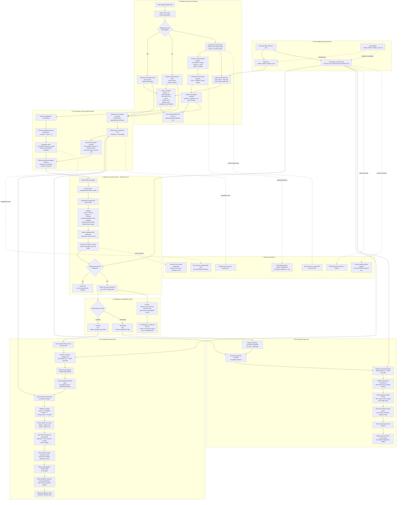

# CLARA uploaded-file encryption and decryption flow

This diagram combines the webapp design documented in
`CLARA_FILE_ENCRYPTION.md` with the current `Strands-runtime` implementation.

The `.claradoc` path creates temporary plaintext inside the isolated Code
Interpreter session. The `.claraimage` path decrypts in runtime memory and
sends plaintext image bytes directly to the vision model without staging a
plaintext image file.

## Written explanation

### 1. The system uses envelope encryption

CLARA does not encrypt every uploaded file directly with the RSA key. Instead,
it uses envelope encryption:

1. A new random 256-bit AES key is generated for every uploaded file.
2. The file is encrypted with that AES key using AES-256-GCM.
3. The much smaller AES key is encrypted, or "wrapped," with the runtime's RSA
   public key using RSA-OAEP with SHA-256.
4. The encrypted file and wrapped AES key travel separately but are associated
   through the generated `stored_name`.

This design makes bulk file encryption efficient while ensuring that only the
AgentCore runtime holding the matching RSA private key can recover each AES
key. Reusing neither the AES key nor the nonce also isolates files from one
another.

### 2. RSA key setup and trust boundary

An RSA-3072 key pair is created in the deployment secret-management
environment:

- The public key is configured in the webapp as `CLARA_AGENT_PUBLIC_KEY`. It is
  used only to wrap per-file AES keys.
- `CLARA_AGENT_PUBLIC_KEY_ID` identifies the key pair in metadata. The current
  runtime supports one active private-key pair, so this identifier does not yet
  select between multiple private keys.
- The private key is configured only in AgentCore as
  `CLARA_FILE_DECRYPTION_PRIVATE_KEY`.

The private key must never be placed in the browser, webapp configuration sent
to clients, Dify, source control, container images, prompts, or logs. The public
key can encrypt data but cannot decrypt a wrapped AES key.

### 3. Encryption during upload

When the web server receives a file, it reads the temporary plaintext and
determines whether it is an image from its MIME type. It then performs the
following operations:

1. Generate a random 32-byte AES key.
2. Generate a random 12-byte GCM nonce.
3. Construct a 21-byte authenticated header:
   - Bytes 0–7: ASCII `CLARAENC`.
   - Byte 8: envelope version `1`.
   - Bytes 9–20: the 12-byte nonce.
4. Encrypt the plaintext with AES-256-GCM and authenticate the complete header
   as additional authenticated data, or AAD.
5. Obtain the 16-byte GCM authentication tag.
6. Wrap the AES key with the RSA public key using OAEP and SHA-256.
7. Zero the in-memory plaintext buffer and AES key and delete the temporary
   plaintext upload.

The object uploaded to Dify has this binary layout:

| Offset | Size | Content |
|---|---:|---|
| 0 | 8 bytes | ASCII `CLARAENC` magic |
| 8 | 1 byte | Envelope version `1` |
| 9 | 12 bytes | AES-GCM nonce |
| 21 | Variable | Encrypted file content |
| End | 16 bytes | AES-GCM authentication tag |

Because the header is used as GCM AAD, changing the magic, version, or nonce
causes authentication and decryption to fail.

### 4. Stored filename and metadata

The webapp generates a safe random stored filename while retaining the original
filename in metadata:

- Images end in `.claraimage`.
- All other encrypted uploads end in `.claradoc`.

The suffix prevents Dify from interpreting ciphertext as a PNG, XLSX, PDF, or
other original format during follow-up validation. The metadata for each file
contains:

- envelope and algorithm versions;
- `key_id`;
- generated `stored_name`;
- `original_name`;
- Base64-encoded RSA-wrapped AES key.

The wrapped AES key is not the plaintext AES key and cannot be used without the
RSA private key. The metadata is still sensitive operational information and
must not be shown to the model or emitted in logs.

### 5. Dify transport and follow-up conversations

Dify receives only the encrypted binary object using
`application/octet-stream`. For a model request, the webapp collects the
metadata for the referenced files, creates a JSON object with
`{ "version": 1, "files": [...] }`, and Base64URL-encodes that JSON into the
`encrypted_document_context` input variable.

The rendered system message includes two related pieces of information:

1. A `<DOCUMENT_INPUT>` or `<IMAGE_INPUT>` block containing the generated
   stored filename and S3 URI.
2. An `<encrypted_document_context>` carrier containing the matching wrapped-key
   metadata.

They are joined by exact `stored_name`, not by their original filename or by a
Dify conversation key such as `conversation_0`.

For follow-up conversations, historical blocks must be rendered as raw text
with real newlines. They must not be inserted as a stringified list or
dictionary containing quotes and literal `\\n` sequences. Each stored filename
must occur in only one encryption manifest within a request.

### 6. Runtime validation before model invocation

The AgentCore runtime processes encryption carriers before invoking the LLM:

1. Find every `<encrypted_document_context>` block in all supplied messages.
2. Base64URL-decode and parse the JSON.
3. Reject carriers larger than 100 KB.
4. Require context version `1` and no more than 30 files.
5. Require `AES-256-GCM`, `RSA-OAEP-256`, and `CLARAENC1`.
6. Require non-empty stored name, original name, wrapped key, and key ID.
7. Reject duplicate stored names.
8. Remove the complete carrier from the messages before the LLM receives them.

If encrypted metadata is supplied but the private-key environment variable is
missing, the request fails immediately. The runtime does not fall back to
reading ciphertext directly or asking the user to upload plaintext.

### 7. Mandatory suffix routing

When valid encryption metadata and the private key are present, the runtime
adds encryption-specific guidance and activates hard tool guards:

- `.claradoc` must go through `stage_encrypted_document`.
- `.claraimage` must go through `analyze_uploaded_image`.
- Generic `execute_command` and `execute_code` calls reject direct access to
  either encrypted suffix.
- `stage_encrypted_document` excludes `.claraimage` metadata.
- `analyze_uploaded_image` fails early when a `.claraimage` has no matching
  encryption metadata.

If a tool sees a `CLARAENC` header, that indicates incorrect routing. It does
not mean the original file is corrupt or unsupported.

### 8. `.claradoc` document decryption

For an encrypted document, the agent calls `stage_encrypted_document` with the
exact stored filename and S3 URI. The tool then:

1. Looks up the metadata by exact stored filename.
2. Loads the runtime's RSA private key.
3. Base64-decodes and unwraps the AES key with RSA-OAEP and SHA-256.
4. Verifies that the recovered AES key is exactly 32 bytes.
5. Creates deterministic, sanitized temporary encrypted and plaintext paths.
6. Instructs the managed Code Interpreter to download the encrypted S3 object.
7. Supplies the AES key transiently to controlled decryption code inside the
   Code Interpreter. The key is not returned to the model.
8. Validates the `CLARAENC` magic, version, and minimum envelope length.
9. Reads the nonce and decrypts `ciphertext + tag` with the header as AAD.
10. Writes the plaintext using exclusive creation so an existing path cannot be
    overwritten.
11. Deletes the temporary encrypted source in a `finally` block.
12. Returns only the plaintext sandbox path to the agent.

The agent can then use Code Interpreter to read the CSV, XLSX, PDF, text, or
other document and produce calculations or artifacts. The plaintext remains
inside the isolated interpreter session and disappears when that session ends.
`ENABLE_TOOL_DETAILS` should remain `false` so internal decryption inputs are
not streamed to clients.

### 9. `.claraimage` image decryption

Images do not use Code Interpreter. The `analyze_uploaded_image` tool:

1. Verifies that the requested stored filename is present in the request's
   `<IMAGE_INPUT>` entries.
2. Requires matching encryption metadata for a `.claraimage`.
3. Downloads a bounded encrypted object directly into runtime memory.
4. Unwraps the AES key with the RSA private key.
5. Validates and decrypts the `CLARAENC1` envelope in memory.
6. Detects the plaintext image format from its magic bytes. Supported formats
   are PNG, JPEG, GIF, and WebP.
7. Sends only the plaintext image bytes and analysis request to the configured
   Bedrock vision model.
8. Returns bounded text analysis to the main agent.

No plaintext image is written to the Code Interpreter filesystem.

### 10. Failure and tamper behavior

The process fails closed in these situations:

- the public or private key is missing;
- the configured private key does not match the public key used for wrapping;
- the metadata carrier is invalid, oversized, duplicated, or unsupported;
- an input filename and metadata `stored_name` do not match exactly;
- the envelope magic or version is invalid;
- the ciphertext, nonce, header, or GCM tag has been modified;
- a `.claraimage` has no matching encryption metadata;
- a generic Code Interpreter tool tries to access an encrypted suffix directly.

AES-GCM authentication ensures that corrupted or modified ciphertext does not
produce unauthenticated plaintext.

### 11. Data visibility summary

| Component | Encrypted file | Wrapped AES key | Plain AES key | Plain file |
|---|---|---|---|---|
| Browser/webapp upload handling | Temporarily creates it | Creates it | Temporary in server memory | Temporary during upload |
| Dify/S3 | Yes | Present in request metadata | No | No |
| Main LLM | File reference only | No; carrier is removed | No | No |
| AgentCore runtime | Can download it | Yes | Temporary in runtime memory | Image path only: temporary in memory |
| Code Interpreter | Document path only | No | Transient controlled document-decryption input | Document path only: temporary sandbox file |
| Vision model | No | No | No | Image bytes only |

### 12. Key rotation

For the current single-key implementation, deploy the new private key to the
runtime first and then switch the webapp public key and key ID. Supporting old
and new files simultaneously during rotation requires extending the runtime to
select a private key by `key_id`. Without that extension, a file wrapped with a
different key pair fails during RSA unwrapping.
